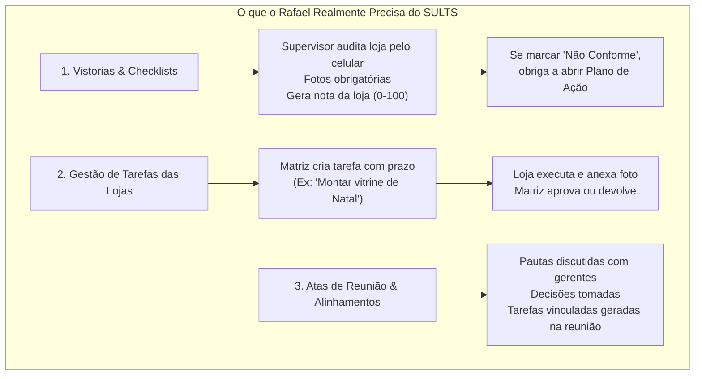

# Estratégia Comercial & Proposta de Negociação — Mega 12 (Sistema 2.0)
> **Documento Estratégico de Precificação, Ancoragem e Roteiro de Negociação**  
> **Autor:** Josué (Engenheiro de Software Principal & Consultor de Tecnologia)  
> **Cliente:** Rafael (Rede Mega 12 — ~20 Lojas Físicas + CD Matriz)  
> **Data:** 12/11/2026  

---

## 🧭 1. Diagnóstico do Histórico & Quebra de Ancoragem

### 1.1 O Que Aconteceu no Primeiro Projeto (V1)
No desenvolvimento inicial do sistema de compras e doca da Mega 12:
- A recomendação inicial de IA (Gemini 3.6) baseou-se em um modelo genérico de "CRUD freelance", sugerindo R$ 6.800.
- A negociação fechou em **R$ 6.000**, a pedido do cliente.
- **O que foi efetivamente entregue:** Um ERP de compras e distribuição multilojas de nível corporativo (cálculos fiscais de ICMS/ST/IPI/PIS/COFINS em tempo real, rateio por grade em 20 lojas simultâneas, controle transacional de concorrência com detecção de versão, pipeline com travas operacionais e rollback autenticado, módulo mobile de conferência de doca/avarias, conciliação de boletos, relatórios em PDF/Excel e deploy Linux/VPS).
- **Valor real de mercado entregue:** **R$ 30.000 a R$ 45.000**.
- **Impacto para a relação:** O Rafael recebeu um sistema muito superior ao preço pago. Isso gerou **confiança cega** e comprovação técnica indiscutível, mas gerou uma **ancoragem psicológica perigosa** na faixa de R$ 6.000.

### 1.2 O Risco Atual
- Se o Sistema 2.0 for precificado em R$ 2.000 a R$ 4.000, o trabalho será novamente subremunerado, desconsiderando a criticidade de colocar o sistema para rodar em 20 lojas físicas diariamente.
- Se for apresentado um orçamento único de R$ 50.000 a R$ 65.000 (valor de software house tradicional), o cliente sofrerá um "choque de ancoragem" (10x o valor original) e travará a negociação.
- **A Solução:** Mudar a narrativa de escopo (Backoffice Matriz vs Operação de Rede 20 Lojas) e fatiar a cobrança em **Marcos Acessíveis** e/ou **Modelo Híbrido com Mensalidade de Sustentação**.

---

## 🎯 2. Entendimento Real do Substituto do SULTS

O **SULTS** ([sults.com.br](https://www.sults.com.br)) é um ecossistema pesado para franquias. O Rafael não precisa de 80% dos módulos do SULTS. Ele precisa exatamente de **três frentes práticas**:

### Por que construir isso nativamente no Mega 12?
- **Economia Brutal de Licenças:** O SULTS cobra por usuário/loja/mês. Para 20 lojas, uma assinatura corporativa consome de **R$ 1.200 a R$ 2.500 todo mês** perpetuamente.
- **Integração Total:** Tudo roda na mesma base de filiais, mesmos logins e mesmos relatórios da Mega 12, sem duplicidade de cadastros.

---

## 💰 3. Cenários de Proposta Comercial

### Cenário 1: "Venda por Marcos de Entrega" (Projeto Fechado)
Ideal se o Rafael preferir pagar por etapas entregues.

| Marco | Escopo Incluído | Valor Sugerido | Prazo Estimado |
|---|---|:---:|:---:|
| **Marco 1: Operação de Caixa & Metas** | • Fechamento de caixa diário simplificado pelas 20 lojas • Painel de conferência e conciliação da Bruna • Memorando Diário Operacional por loja • Motor de Metas (+5% / +10%) e Ticket Médio automático | **R$ 8.900,00** *(ou 3x R$ 2.966)* | 2 a 3 semanas |
| **Marco 2: Auditoria de Campo (Substituto SULTS) & Validades** | • Checklists de supervisão mobile com upload de fotos • Gestão de tarefas com comprovação por imagem • Atas de reuniões com tarefas vinculadas • Controle de lotes, validades e alertas nas lojas | **R$ 8.500,00** *(ou 3x R$ 2.833)* | 2 a 3 semanas |
| **Marco 3: DRE por Filial & BI Gerencial** | • Cruzamento de vendas diárias com despesas do financeiro • DRE por filial, DRE da Matriz e DRE Consolidado • Dashboard executivo de lucratividade real por unidade | **R$ 4.900,00** *(ou 2x R$ 2.450)* | 1 a 2 semanas |
| **PACOTE COMPLETO (Marcos 1 + 2 + 3)** | **Todos os módulos contratados juntos (Desconto de Pacote)** | **R$ 19.800,00** *(ou 4x R$ 4.950)* | 6 a 8 semanas |

---

### Cenário 2: "Modelo Híbrido: Implantação + Retainer Mensal" (⭐ O Mais Recomendado)
Este é o modelo mais inteligente tanto para você quanto para o Rafael. Com 20 lojas acessando o sistema todo dia, o suporte e a manutenção contínua tornam-se essenciais.

- **Taxa de Implantação do Marco 1 (Caixa + Metas + Bruna):** **R$ 6.800,00** (parcelado em 2x ou 3x).
- **Mensalidade de Sustentação & Evolução Contínua:** **R$ 1.600,00 a R$ 1.800,00 / mês**.
  - **O que a mensalidade cobre:**
    1. Manutenção preventiva e monitoramento contínuo da VPS Linux e banco SQLite.
    2. Rotinas automáticas de backup diário com retenção em nuvem.
    3. Suporte técnico à matriz (Bruna/Rafael) e resolução de dúvidas operacionais das lojas.
    4. **Desenvolvimento contínuo:** Os módulos dos Marcos 2 e 3 (substituto do SULTS, validades e DRE) vão sendo construídos e liberados mês a mês dentro da própria mensalidade!
  - **Por que é excelente para o Rafael?**
    - Desembolso inicial suave (R$ 6.800).
    - Custo mensal previsível (menos de R$ 90 por loja/mês — muito mais barato que qualquer SaaS do mercado).
  - **Por que é excelente para você?**
    - Garante **R$ 19.200 a R$ 21.600 por ano de receita recorrente e previsível**.
    - Elimina o desgaste de negociar orçamentos a cada novo botão ou tela que o cliente pedir.

---

## 🗣️ 4. Roteiro de Conversa & Pitch com o Rafael

### Etapa 1: Abertura e Validação de Escopo
> *"Fala Rafael, tranquilo? Cara, analisei tudo que a gente conversou nos áudios, ouvi com calma e desenhei a estrutura para o 2.0.*  
> *O que você precisa agora não é só um ajustezinho de compras; a gente vai colocar o sistema para rodar dentro de 20 lojas físicas todo santo dia. Isso muda a empresa de patamar: vai tirar 4 horas diárias de retrabalho manual da Bruna, vai colocar a meta na cara das meninas na abertura do dia e vai te dar o controle que você hoje procura no SULTS sem você precisar pagar mensalidade de licença por loja para terceiros."*

### Etapa 2: Explicando a Diferença em Relação ao Primeiro Projeto
> *"Naquele primeiro projeto de R$ 6.000, eu fiz um preço super especial de entrada porque nosso foco era validar a esteira de compras e o CD. Eu entreguei muito mais coisas além do escopo inicial (cálculos fiscais, relatórios em PDF, doca mobile) porque queria ver a esteira rodando limpa e sem travas.*  
> *Agora, para a gente colocar as 20 lojas no ar e criar o módulo que substitui o SULTS, estudei o melhor caminho para não ficar pesado para a Mega 12 e ser sustentável tecnicamente."*

### Etapa 3: Apresentando a Solução (Escolha a sua preferência)

#### Se optar pelo Modelo Híbrido (Mensalidade):
> *"Minha sugestão para você: a gente faz uma taxa de implantação de R$ 6.800 para colocar a Fase 1 no ar agora (Fechamento de Caixa, painel da Bruna, Memorando diário e o painel de Metas com o Ticket Médio), e a gente alinha uma mensalidade de R$ 1.600/mês.*  
> *Com essa mensalidade, eu cuido de todo o suporte das lojas e da VPS, e dentro dela já vou construindo e liberando para você o módulo de auditoria com fotos e tarefas (o substituto do SULTS) e o DRE. Você economiza o que pagaria para o SULTS e tem o desenvolvedor sênior cuidando de toda a tecnologia da sua rede."*

#### Se optar pelo Projeto Fechado (Por Marcos):
> *"A gente pode fatiar em duas etapas bem claras:*  
> *1. O Marco 1 (Caixa + Painel da Bruna + Metas + Memorando): R$ 8.900 parcelado em 3x, entregue a tempo da virada de ano.*  
> *2. O Marco 2 (Substituto do SULTS com fotos/tarefas + Controle de Validades): R$ 8.500 logo em seguida.*  
> *Se fechar o pacote completo agora, faço tudo por R$ 19.800 em 4 vezes."*

---

## 🛡️ 5. Conclusão e Próximos Passos
1. Aguardar o feedback do Rafael sobre a preferência de contratação (Projeto por Marcos vs Implantação + Mensalidade).
2. Obter os modelos físicos dos relatórios que as lojas já enviam para a Bruna.
3. Iniciar imediatamente o desenho da tela de **Lançamento de Caixa da Loja** e **Painel de Auditoria da Bruna**.

