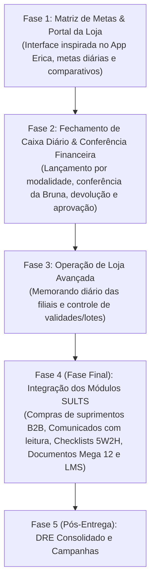

# Planejamento & Questionário de Requisitos - Mega 12 (Sistema 2.0)
> **Documento Normativo e Analítico de Levantamento de Requisitos**  
> **Origem dos Dados:** Alinhamento Técnico entre Rafael e Josué (Áudios de 12/11/2026)  
> **Objetivo:** Estruturar as premissas, regras de negócio e informações necessárias para a expansão do sistema aos terminais de loja da rede física no próximo ano.

**Estado:** levantamento e proposta; cálculos e fluxos abaixo devem ser validados com Rafael e Bruna antes da implementação. As falas transcritas são a fonte das necessidades, enquanto as fórmulas e campos detalhados são propostas de desenho.

**Decisão de 12/11/2026:** suspender o início da implementação até dimensionar o trabalho e preparar orçamento. A hipótese inicial abrangia todo o sistema web, ampla expansão do APK Android e diversos módulos inspirados no SULTS; ela foi refinada no recorte abaixo. Ver `ORCAMENTO_REVISADO_SISTEMA_2.0.md` para a estimativa vigente.

**Recorte comercial posterior (prioridade atual):** a loja acessa sua unidade, registra o **resultado final da venda diária e um memorando**, e acompanha as metas. O lançamento segue para **Bruna (financeiro) conferir e aprovar ou devolver com motivo para correção**; o histórico preserva autor, valores e decisões. Rafael define/publica metas em um **módulo próprio da matriz**, que alimenta a visualização da loja. Não há PDV nem conciliação automática de meios de pagamento neste recorte. A referência SULTS restringe-se inicialmente a **identificar problemas e melhorias da unidade, atribuir tarefas, registrar imagens/evidências e organizar reuniões (agenda e pautas)**, com uso pertinente no Android. Campanhas e gastos promocionais continuam em escopo básico. Detalhamento de caixa por pagamento, validades, treinamentos, chamados, CRM/B2B e demais módulos **não estão incluídos automaticamente** no orçamento atual. A avaliação comercial vigente está em `ORCAMENTO_REVISADO_SISTEMA_2.0.md`.

**Atualização de 17/11/2026 para a proposta comercial de R$ 8.800,00:** o portal das lojas registra um **fechamento consolidado do caixa diário**, sem cadastro individual de vendas e sem PDV. Cada loja informa total de vendas do dia, quantidade de vendas, dinheiro, cartão de débito, cartão de crédito, Pix Kais, Pix Stone, Pix CNPJ, despesas discriminadas por valor e motivo e memorando. Bruna confere o fechamento e aprova ou devolve com justificativa. Este recorte posterior **inclui** a discriminação por forma de pagamento; a ressalva anterior sobre exclusão desse detalhamento se refere a uma versão anterior do orçamento.

**Atualização de 22/11/2026 (Consolidação da Arquitetura do Portal das Lojas):**
1. **Autenticação por Unidade:** o login será realizado diretamente pelo terminal da unidade física (usuário/senha da filial), dispensando credenciais individuais complexas. No momento da submissão do caixa ou do memorando, a colaboradora registra seu nome/identificação simples para manter a rastreabilidade e auditoria.
2. **Cabeçalho Principal & Termômetro de Metas (Evolução App Erica):** o topo da tela será o próprio termômetro de metas, com uma barra unificada e proporcional. A barra total representa a Supermeta (100%), possuindo uma demarcação visual que indica o ponto onde se atinge a Meta (verde até a Meta; dourado no trecho complementar da Supermeta). O cartão indicador em destaque foca prioritariamente na Supermeta (alvo e valor faltante).
3. **Calendário Mensal Interativo (Fusão de Status e Histórico Diário):** os funcionários visualizam um calendário interativo onde cada dia é colorido por status: 🟢 Verde (caixa fechado e aprovado pelo financeiro), 🔵 Azul (em conferência pela Bruna), 🔴 Vermelho (devolvido/requer conferência e correção). Ao clicar no dia, abre-se o modal do caixa.
4. **Alerta no Cabeçalho:** se houver fechamentos em vermelho (devolvidos com motivo pela Bruna), um banner de aviso surge no cabeçalho orientando a correção imediata.
5. **Modal de Fechamento de Caixa:** a quantidade de vendas passa a ser opcional (preenchível pela loja se houver dado no PDV, ou posteriormente pela diretoria/Bruna). As despesas/sangrias tornam-se uma lista dinâmica com botão de inclusão linha a linha (`[Descrição]`, `[Valor R$]`). O campo de texto livre é denominado `"Memorando do Dia"`.
6. **Pendência de Feriados:** mantida em aberto a definição de como será a indicação e validação de feriados locais/municipais (tanto pela diretoria no calendário geral quanto pelas unidades).

**Atualização de 23/11/2026 (Especificação Técnica Aprovada: Controle de Validades, Lotes e Alertas na Doca, Loja e Bryan):**
Definição consensual para o módulo de rastreamento de produtos perecíveis e datas de validade da Rede Mega 12 (programado para implantação imediatamente após a conclusão e estabilização operacional da tela das unidades):
1. **Ponto de Coleta na Doca/Separação:** campo opcional de *Data de Validade* adicionado durante a conferência física e distribuição de cotas para as lojas no Centro de Distribuição. Não obrigatório para produtos secos ou sem validade.
2. **Rastreabilidade Fina por Loja Destinatária:** o sistema vincula o lote e a validade exclusivamente às filiais que receberam quantidade física alocada (`quantity_allocated > 0`), impedindo disparos errôneos para lojas que não receberam o item.
3. **Visão Proativa de 30 Dias (Tela Exclusiva da Loja):** nova tela/seção elegante no portal da unidade listando todos os produtos com vencimento nos próximos 30 dias para planejamento de gôndola e ações comerciais preventivas.
4. **Disparo do Alerta Ativo de 15 Dias (Simultâneo: Loja + Perfil Bryan):**
   - Disparo web simultâneo para as lojas que receberam o produto e para o usuário com perfil do Bryan (Comprador/Gestão Comercial).
   - Ações da Loja no Alerta:
     - `[ ⏰ Vou conferir ]`: postergador (snooze) automático de 2 horas. O alerta se recolhe e reaparece após 2h para assegurar a conferência.
     - `[ ✅ Conferido ]`: a loja registra que o item foi verificado fisicamente, informa se ainda há saldo ou se já esgotou e conclui a pendência.
   - Ações do Bryan: monitoramento em tempo real do status das filiais com acionamento direto via WhatsApp para lojas com alerta pendente há muito tempo.
5. **Lembrete Crítico no Dia do Vencimento (Dia D):** aviso sonoro e visual pontual na data exata para retirada imediata do produto da área de vendas caso ainda reste saldo em estoque.
6. **Estrutura de Persistência:** tabela dedicada `store_product_validities` no banco relacional SQLite integrado ao backend Express.

**Decisão Estratégica de 19/11/2026 (Integração SULTS como Fase Final do Sistema 2.0):**
Conforme alinhamento técnico e análise minuciosa do vídeo gravado pelo Bryan (`WhatsApp Video 2026-11-19 at 14.20.53.mp4`), a internalização dos módulos operacionais do SULTS **não será feita como um sistema isolado** (rejeita-se a criação de um segundo banco/servidor NestJS/PostgreSQL a partir de `Sults`). Toda a estrutura será integrada **diretamente no sistema em produção (`App Rafael`)**, compartilhando o backend Express, o banco SQLite relacional (`mega12.db`), a camada de autenticação JWT unificada (Single Sign-On) e o frontend modularizado em React Router. Esta integração dos módulos SULTS selecionados constituirá formalmente a **FASE FINAL DA TRANSIÇÃO 2.0**, sucedendo a entrega do núcleo operacional de metas, caixas e conferência financeira.

**Regra de consistência ainda pendente:** no fechamento de exemplo recebido, as formas de pagamento somam R$ 7.064,94 e as despesas detalhadas somam R$ 490,01. Subtraí-las produz R$ 6.574,93, enquanto o “Total Caixa” informado é R$ 5.902,40; há uma diferença de R$ 672,53 que não deve ser interpretada automaticamente como erro. Existe uma quantia reservada para troco, mas seu valor e os demais possíveis movimentos ainda não foram levantados. Registrar como **melhoria futura a avaliar** um alerta de divergência entre totais, sem presumir fórmula, sem bloquear o envio e sem incluí-lo no escopo fechado da proposta. Antes de implementar, confirmar com Bruna o significado de “Total Caixa”, fundo de troco, sangrias, entradas/saídas e critérios de conferência.

---

## 🧭 1. Visão Geral da Expansão (Sistema 2.0)

O sistema atual consolidou com excelência a espinha dorsal de retaguarda:
- Compras e Cotações Comerciais;
- Separação Física, Doca e Romaneios de Carga;
- Distribuição Inteligente entre as Filiais;
- Estoque Central e Auditoria de Operações.

A fase 2.0 visa levar o sistema aos **terminais das lojas físicas**. Rafael pediu para começar pelo **esboço das metas**, preparando a operação para 2027. O sistema de vendas/PDV existente continua sendo a origem das vendas; nesta etapa o ERP receberá totais diários e, quando disponível, a quantidade de vendas. A tela da loja exibirá informações restritas à sua filial.

O `Portal ERP Joia` já contém compras, distribuição, estoque central, financeiro, usuários e habilitação de módulos por empresa. O `Sults` contém a especificação inspirada no SULTS e uma base técnica. **Supervisão, checklists, planos de ação, comunicados e treinamentos fazem parte da V2**, adaptados à Mega 12 e integrados aos mesmos cadastros, permissões e histórico. O DRE fica para a última etapa ou para um projeto paralelo.

**Referência aprovada para a experiência de metas:** o projeto Android `App Erica/` foi fornecido por Josué para incorporação fiel da estrutura visual e do funcionamento de acompanhamento diário. A especificação detalhada da incorporação está na seção **3.4**. A fidelidade é de fluxo, aparência e comportamento observável; armazenamento, identidade e autorização passam a ser centralizados no portal.

---

## 📋 2. Questionário de Levantamento de Requisitos (5 Blocos Estratégicos)

### Bloco 1: Fechamento de Caixa Diário das Lojas & Auditoria (Bruna)
*Objetivo: Descentralizar o lançamento dos caixas pelas filiais e automatizar a conciliação hoje feita manualmente pela Bruna até as 14h.*

1. **Rotina e Origem dos Dados no PDV:**
   - Como as lojas operam o caixa hoje? Existe um software emissor de cupom/NFC-e ou relatório Z nas filiais?
   - De que forma as colaboradoras enviam o fechamento atualmente? (Foto de comprovantes pelo WhatsApp, anotação em papel, planilha?).
2. **Campos Obrigatórios de Lançamento:**
   - Quais as formas de pagamento que devem ser discriminadas no fechamento?
     - Dinheiro em espécie (R$)
     - Pix (R$)
     - Cartão de Débito (R$)
     - Cartão de Crédito (R$)
     - Venda Faturada / Convênio (se houver)
   - Há controle de **Troco Inicial (Fundo de Caixa)** na abertura do dia?
   - Há registro de **Sangrias / Despesas Locais** pagas pelo caixa da loja (ex.: compras miúdas de limpeza, correio, alimentação)?
3. **Volume de Vendas & Ticket Médio Automático:**
   - O relatório emitido na loja já fornece a **quantidade de vendas / cupons emitidos** no dia?
   - *Proposta:* Se a colaboradora registrar `Qtd. Vendas do Dia`, o sistema calcula o **ticket médio** diário e mensal sem exigir digitação mensal de Rafael. Confirmar se o dado aparece no relatório do PDV; uma integração poderá substituir a digitação futuramente.
4. **Tela de Auditoria e Conciliação (Bruna):**
   - Como a Bruna deve visualizar esses fechamentos?
   - Sugestão: fila de fechamentos `[Enviado / Em conferência / Divergente / Conciliado]`, com comparação aos relatórios ou extratos que Bruna realmente utiliza. Sem uma segunda fonte de dados, o sistema apenas soma e valida a consistência do lançamento; não deve declarar conciliação automática.
   - Registrar devolução para correção, motivo, versão anterior, anexos e aprovação. Definir tratamento de estornos, cancelamentos, taxas, sangrias e fechamento de dia sem vendas.

---

### Bloco 2: Motor de Metas, Supermetas e Calendário Comparativo
*Objetivo: Oferecer às lojas uma visão em tempo real de quanto falta para atingir a meta, com base histórica no mesmo período do ano anterior.*

1. **Base Histórica de Vendas:**
   - De onde será importado o histórico de vendas de 2025/2026 por loja? (Planilhas de faturamento mensal ou relatórios do PDV?). Registrar fonte, período, data de importação e responsável. Totais **mensais** bastam para a meta mensal; comparações **diárias** com o ano anterior exigem histórico diário.
2. **Ponderação por Dias Úteis:**
   - Fórmula: $\text{Média Diária Base} = \frac{\text{Venda do Mês no Ano Anterior}}{\text{Dias Úteis do Ano Anterior}}$
   - $\text{Venda Projetada Atual} = \text{Média Diária Base} \times \text{Dias Úteis do Mês Atual}$
   - As lojas possuem calendários de funcionamento distintos (ex.: lojas de shopping/centro com horários diferentes aos domingos e feriados)?
3. **Regra de Cálculo das Metas:**
   - **Meta proposta:** Venda Projetada $\times 1{,}05$.
   - **Supermeta proposta:** Meta $\times 1{,}10$ = Venda Projetada $\times 1{,}155$; portanto **15,5% acima da projeção**, não 15%.
   - Aplicar o piso mínimo da loja quando for maior que a meta calculada. Confirmar se a supermeta incide sobre a meta final após esse piso.
   - A diretoria poderá ajustar manualmente a meta projetada quando uma loja passar por reforma, ampliação ou troca de ponto comercial? Guardar justificativa, aprovador, fórmula, dados de entrada e versões publicadas. O calendário deve considerar **dias de venda reais**, que não são necessariamente dias úteis de segunda a sexta.
4. **Painel de Gamificação e Visualização na Loja:**
   - Exibição em destaque na tela inicial da loja:
     - `Vendido Hoje:` R$ X (e número de vendas, quando informado)
     - `Acumulado no Mês:` R$ Y
     - `Falta para a Meta:` R$ Z (% atingido)
     - `Falta para a Supermeta:` R$ W
   - Mostrar a origem e o estado do acumulado: fechamento provisório enviado ou valor conferido. O sistema não deve apresentar dados históricos mensais como se fossem vendas de cada dia.

---

### Bloco 3: Memorando Diário Operacional (Diário de Bordo da Rede)
*Objetivo: Evitar perda de conhecimento histórico e apoiar decisões comerciais em datas comemorativas e feriados futuros.*

1. **Responsabilidade e Preenchimento:**
   - O memorando será preenchido diariamente no momento do fechamento de caixa pela encarregada da loja? Rafael deseja que o registro normal seja feito **no próprio dia**. Definir hora limite e política de correção posterior com justificativa e aprovação, sem alterar silenciosamente o original.
2. **Parâmetros de Contexto a Registrar:**
   - **Condições Climáticas:** Ensolarado, Chuva forte, Frio intenso (impacto direto no fluxo de pedestres).
   - **Horário Especial de Abertura:** Abertura normal (09h-18h), Estendido (até 20h/22h), Domingo/Feriado.
   - **Evento / Feriado / Data Comercial:** Black Friday, Dia das Mães, Aniversário do Município, etc.
   - **Parecer Operacional (Feedback da Encarregada):** Campo livre para observações (ex.: *"Abrimos até as 21h, mas após as 19h não houve fluxo de clientes; recomendável fechar às 19h30 no ano que vem"*).
3. **Mecanismo de Consulta Retrospectiva:**
   - No ano seguinte, ao abrir o calendário de metas de uma data, o sistema exibe um card:  
     `📅 Ocorrências Registradas neste mesmo dia no ano anterior: [Ver Detalhes]`.
   - Além da data civil, permitir busca por loja, feriado, evento e período equivalente; datas móveis e mudanças de calendário não caem sempre no mesmo dia do ano.

---

### Bloco 4: Controle de Validades e Alertas de Lote (Especificação Final Aprovada)
*Objetivo: Notificar as lojas e a gestão comercial com antecedência sobre itens perecíveis próximos ao vencimento, viabilizando queima de estoque, remanejamento e eliminação de perdas financeiras.*

1. **Momento da Coleta da Data de Validade (Doca / Separação):**
   - A coleta ocorre exclusivamente no módulo de **Separação & Doca (`SeparationPage.tsx`)**, quando o operador confere as quantidades físicas e aloca as cotas para as filiais.
   - **Campo Opcional:** `Data de Validade` (com máscara `DD/MM/AAAA`).
   - Se o produto for não perecível (ex.: utilidades domésticas, plásticos), o operador deixa em branco.
   - Se o produto tiver validade (alimentos, bebidas, cosméticos, químicos), a data é digitada uma única vez para aquele item/lote.

2. **Rastreabilidade Fina por Loja Destinatária:**
   - O sistema herda as cotas distribuídas na grade (`separacaoLojas`) e grava no banco exclusivamente para as filiais que receberam quantidade física (`quantity_allocated > 0`).
   - Garante que filiais que não receberam o lote nunca recebam alertas indevidos.

3. **Visão Proativa de 30 Dias (Tela Elegante na Loja):**
   - As lojas contam com uma aba/tela dedicada de **"Controle de Validades"** onde visualizam com até **30 dias de antecedência** a lista elegante dos produtos a vencer.
   - Exibe foto/código do produto, lote, quantidade recebida da matriz, data de vencimento e contagem regressiva em dias (`badge` visual: 🔴 ≤ 7 dias, 🟡 ≤ 15 dias, 🔵 ≤ 30 dias).
   - Não bloqueia a tela, servindo para planejamento e ações de merchandising.

4. **Gatilho de Alerta Ativo de 15 Dias (Disparo Simultâneo: Loja + Perfil Bryan):**
   - Quando faltarem exatamente **15 dias** para o vencimento do produto, um alerta proativo é disparado simultaneamente:
     - **Na Web da Loja:** Exibição de box/modal prioritário na tela da unidade destinatária.
     - **No Perfil do Bryan (Comprador/Gestão):** Exibição na central de monitoramento da matriz.
   - **Ações Disponíveis para a Loja no Alerta:**
     - `[ ⏰ Vou conferir ]`: Aciona um postergador automático de **2 horas (snooze)**. O alerta se recolhe temporariamente e volta a aparecer após 2h para garantir que a equipe não esqueça a conferência.
     - `[ ✅ Conferido ]`: A colaboradora confirma que o produto foi checado fisicamente na gôndola/estoque e informa se ainda restam unidades ou se já foi 100% vendido (esgotado).
   - **Ações do Bryan:** Visualização em tempo real de quais lojas clicaram em *Conferido*, quais estão em *Vou conferir* (com timer) e quais ainda estão *Pendentes*, com botão de contato direto via WhatsApp com a gerente da filial.

5. **Lembrete Crítico no Dia do Vencimento (Dia D):**
   - Na data exata do vencimento (`data_atual == expiration_date`), um lembrete crítico surge na loja alertando: *"O produto [Nome] vence hoje. Favor retirar imediatamente da área de vendas caso ainda reste saldo físico."*

6. **Modelagem de Dados Relacional (SQLite):**
   - Tabela dedicada `store_product_validities` registrando `order_id`, `item_id`, `product_id`, `product_name`, `store_id`, `quantity_allocated`, `expiration_date`, `batch_number`, `alert_15d_status`, `alert_15d_snoozed_until`, `stock_remaining` e `due_day_acknowledged`.
   - Programado para implantação no momento em que a tela das unidades (caixas, metas e conferência) estiver totalmente validada e operacional.

---

### Bloco 5: Perfis de Acesso & Segurança nas Lojas (RBAC & Ergonomia)
*Objetivo: Garantir conformidade com as diretrizes do AGENTS.md (Security by Design, isolamento de dados e fluidez de uso).*

1. **Modelo de Autenticação nas Lojas:**
   - Preferir logins **individuais** vinculados a uma ou mais lojas para identificar quem lançou, corrigiu e aprovou cada fechamento. Um usuário compartilhado ou senha padrão impediria uma auditoria confiável. Confirmar como gerenciar substituições de encarregada e acesso temporário.
2. **Matriz de Permissões Estritas (Menor Privilégio):**
   - Usuário de Loja:
     - Visualizar **Metas e Supermetas** da sua própria filial.
     - Registrar o **Fechamento de Caixa** e o **Memorando Diário** da sua filial.
     - Responder aos **Alertas de Validade**.
     - **Bloqueado:** Não visualiza custos de compra, margens globais de fornecedores, dados financeiros da matriz ou de outras filiais.

---

## 🧩 3. Estrutura funcional e técnica proposta

### 3.1 Um portal, áreas por perfil

| Área | Usuários | Rotina principal |
|---|---|---|
| Administração da plataforma | proprietário do portal | empresas, módulos contratados, configuração e suporte do serviço; sem acesso operacional irrestrito aos dados das lojas |
| Matriz / diretoria | Rafael e gestores autorizados | metas, visão consolidada, compras, estoque central, financeiro, comunicados e acompanhamento de lojas |
| Conferência | Bruna e equipe autorizada | fila de caixas enviados, comprovantes, divergências, devoluções e aprovação |
| Supervisão | supervisores | roteiro de visitas, checklists, fotos, não conformidades, planos de ação e acompanhamento |
| Loja | encarregada e colaboradoras autorizadas | **tela inicial própria** com meta e avisos; lançar vendas/caixa e memorando do dia; responder validade, comunicados, checklists e treinamentos pertinentes |

A área da loja terá como núcleo de vendas a navegação do `App Erica`: **Início, Definir Metas, Gráfico e Configurações**. A aba **Definir Metas** preserva a apresentação do app, mas apenas a diretoria poderá editar e publicar valores; para a loja, mostrará os valores publicados sem controles de alteração. Memorando, fechamento/conferência, alertas e atividades SULTS entram por ações e pendências complementares, sem substituir essas quatro áreas. A loja acessa apenas sua filial, exceto quando um usuário receber autorização explícita para mais de uma unidade.

### 3.2 Integração dos Módulos SULTS (Fase Final da Mudança 2.0)

A integração dos módulos operacionais do SULTS é formalmente definida como a **fase final da transição 2.0**. Em vez de manter duas plataformas ou construir um sistema paralelo, as rotinas selecionadas do SULTS serão incorporadas diretamente ao `App Rafael` (backend Express + SQLite `mega12.db` e frontend React Router modular), aproveitando a base de usuários, permissões e cadastro de filiais já existente.

#### 3.2.1 Matriz de Decisão dos Módulos (Auditoria do Vídeo do Bryan em 19/11/2026)

A análise frame a frame e a transcrição integral do áudio de Bryan (`WhatsApp Video 2026-11-19 at 14.20.53.mp4`) fixaram as seguintes decisões operacionais:

| Módulo SULTS | O que faz no SULTS | Fala do Bryan no Vídeo | Veredito | Estratégia de Integração no Sistema 2.0 |
|---|---|---|:---:|---|
| **Compras** | Requisição de materiais de consumo, sacolas, bobinas térmicas e insumos de loja | *"Sistema de Compras, que a gente usa pra... pra fazer compras de materiais de expediente, sacolas, essas coisas assim."* | ✅ **CONFIRMADO** | Catálogo interno de insumos/expediente onde a loja solicita e a matriz/depósito separa e envia. |
| **Comunicados** | Circulares, avisos operacionais, alertas urgentes com confirmação de leitura | *"Os Comunicados, que daí a gente larga os avisos né."* | ✅ **CONFIRMADO** | Feed na tela inicial, pop-ups bloqueantes para avisos urgentes e relatório de quem leu/confirmou. |
| **Checklist** | Vistoria técnica e operacional dos supervisores nas lojas físicas | *"O Checklist do supervisor."* | ✅ **CONFIRMADO** | Questionários por seção com fotos obrigatórias na reprovação e pontuação de conformidade. |
| **Planos de Ação (5W2H)** | Correção de não conformidades apontadas nos checklists | Desdobramento automático das reprovações críticas do checklist | ✅ **CONFIRMADO** | Abertura automática de pendências com prazo, responsável e envio de foto de comprovação da loja. |
| **Mega 12 (Pessoas & Docs)** | Repositório central de documentos da rede e colaboradores | *"Mega 12 é pra todos os documentos, dá pra guardar documento, cadastrar pessoas também."* | ✅ **CONFIRMADO** | Disco Virtual (GED) por pastas (alvarás, contratos, manuais) e ficha de colaboradores da unidade. |
| **Unidades** | Cadastro de lojas físicas/filiais e seus acessos | *"As Unidades que a gente cadastra todas as unidades que são né, pra elas terem um acesso a isso..."* | ✅ **CONFIRMADO** | Tabela relacional de filiais (`units`), vinculando usuários, gerentes, endereço, CNPJ e metas. |
| **Universidade Corporativa** | Treinamento de funcionários, integração e capacitação em vídeo/manuais | *"Universidade Corporativa é onde a gente faz os treinamentos do SULTS, e a gente treina o... interno da loja né."* | ✅ **CONFIRMADO** | Módulo LMS com módulos, videoaulas, manuais em PDF e questionários de fixação da equipe. |
| **Implantação de Unidades** | Checklist e plano de inauguração de novas lojas | *"Implantação de Unidades, que é quando vai inaugurar uma loja dá pra usar um checklist e fazer um plano né."* | ✅ **CONFIRMADO** | Cronograma de tarefas e checklist pré-inauguração para abertura de novas filiais da rede. |
| **Analytics** | Gráficos e indicadores dos checklists e desempenho de lojas | *"Os Analytics, que é análise de checklist e coisa assim."* | ✅ **CONFIRMADO** | Painel de BI com ranking de notas das lojas, histórico de conformidade e tempo de resolução. |
| **Agenda** | Calendário de visitas de supervisores e reuniões | *"Agenda não usa tanto, mas dá pra pôr, uma agendinha."* | 🟡 **OPCIONAL** | Calendário mensal simples exibindo datas das visitas agendadas de supervisores e reuniões da rede. |
| **NES (Clima Interno)** | Pesquisa de satisfação da equipe das lojas (Net Employee Score) | *"O NES é um negócio de pra saber como é que tá as lojas, ou se tá tudo bem, dá pra fazer tipo uns questionários."* | 🟡 **AVALIAR** | Questionários rápidos periódicos para colaboradores avaliarem anonimamente o clima da unidade. |
| **NPS** | Pesquisa de satisfação com nota (Net Promoter Score) | *"Esse NPS também quase a mesma coisa."* | 🟡 **AVALIAR** | Pesquisa de satisfação com nota de 0 a 10 e feedback aberto. |
| **Chamados (Helpdesk)** | Suporte e solicitações das lojas para a Matriz (TI, manutenção, financeiro) | Presente no topo do SULTS, essencial para suporte | 🟡 **AVALIAR** | Fila de tickets por categoria com SLA, mensagens e anexos entre loja e departamentos da matriz. |
| **Termos LGPD & Jornada** | Aceite de termos e registro de jornada do supervisor | *"E os Termos LGPD é os... os treinamentos/termos... Jornada é de serviço/tempo que fazem..."* | 🟡 **OPCIONAL** | Aceite digital de políticas internas no primeiro login; registro de check-in na loja. |
| **Rede Social** | Feed social interno estilo mural | *"A Rede Social acho que não é preciso."* | ❌ **DESCARTADO** | Fora do escopo (substituído plenamente pelo módulo de Comunicados). |
| **Integração / Expansão** | CRM de captação e venda de franquias | *"Integração Expansão não."* | ❌ **DESCARTADO** | Fora do escopo da rede própria Mega 12. |
| **Marketing** | Banco de artes publicitárias e campanhas externas | *"Marketing também não."* | ❌ **DESCARTADO** | Fora do escopo inicial (ver 3.2.2 para campanhas promocionais de vendas). |

#### 3.2.2 Arquitetura de Reutilização dos Modelos de `Sults`
A pasta `Sults` contém a modelagem conceitual relacional pronta em `apps/api/prisma/schema.prisma` e as regras de negócio em `ANTIGRAVITY_SULTS_SPEC.md`. Em vez de executar aquela stack (NestJS/Prisma/Postgres):
1. **Transposição Direta para SQLite:** Os schemas de `units`, `announcements`, `checklists`, `action_plans`, `b2b_orders`, `disk_folders/files` e `lms_courses` são adaptados diretamente em migrações SQL no banco `mega12.db`.
2. **Reaproveitamento de Rotas e Serviços:** Os controllers e services são criados seguindo o padrão Clean Architecture já adotado no `backend/src/` do `App Rafael`.
3. **Frontend Integrado:** As telas são construídas em `web/src/modules/` aproveitando o Design System consolidado (`theme.css`, `CurrencyInput`, `NumericInput`, `Button`, `Modal`) e integradas ao `AppRoutes.tsx` com navegação multi-páginas via `react-router-dom`.

### 3.2.1 Campanhas e investimentos promocionais

Prever planejamento por período, data festiva e loja; objetivo, orçamento aprovado, ações e canais, peças e produtos participantes, gastos previstos/realizados com comprovantes, responsáveis, execução na loja, vendas/resultados e análise posterior. Matriz publica campanha; unidade visualiza tarefas e registra execução conforme permissão. Cruzar com vendas/metas e memorandos sem duplicar receita. Antes de divulgar ROI/lucro, acordar método de atribuição, base comparativa, margem e custos. Integrações com PDV e plataformas de anúncios exigem levantamento e orçamento próprios.

### 3.3 Dados e limites de acesso

O portal mantém empresa, habilitação de módulos e administração da assinatura. Cada empresa mantém lojas, usuários, metas, caixas, memorandos, inspeções, tarefas e treinamentos em seu espaço de dados. Criar vínculo explícito **usuário ↔ loja ↔ permissões**; validar no servidor tanto o módulo habilitado quanto a loja permitida em cada operação. Um mesmo registro pode aparecer em diferentes painéis, mas continua com um único identificador e histórico.

O **SQLite por empresa já usado pelo portal será a persistência oficial também dos registros das lojas**: vendas diárias, metas, calendário, memorandos e conferências. Implementar migrações no banco existente de cada tenant, transações, chaves únicas, índices, integridade, backups e política de acesso concorrente; não criar banco isolado no navegador ou por aparelho. Fotos, comprovantes e materiais de treinamento podem ser armazenados em arquivos/objetos com referências e permissões no SQLite. Monitorar volume de escritas e duração das transações na implantação.

### 3.4 Incorporação fiel do App Erica na página autenticada da loja

**Referência de produto:** `App Erica/app/src/main/java/com/erica/metas/`. A análise abrange `MainActivity.kt`, `SalesModels.kt`, `SalesViewModel.kt`, as quatro telas em `ui/screens/`, `BottomNavigationBar.kt`, `DailySalesItem.kt`, `EvolutionProgressBar.kt`, `CurrencyAmountInput.kt`, `ConfettiEffect.kt` e `CurrencyUtils.kt`. A referência visual **em uso** é a barra horizontal `EvolutionProgressBar`; `LiquidProgressBar.kt` existe, mas não é usada pela tela inicial. Incorporar **estrutura, ordem das telas, linguagem visual e funcionamento percebido** ao frontend web React do portal, com API Express e SQLite do tenant. Não tentar executar componentes Jetpack Compose no navegador.

#### 3.4.1 Entrada e estrutura de navegação

1. Login individual pelo portal da empresa → sessão autenticada → servidor resolve empresa, usuário e loja(s) autorizada(s) → perfil de loja abre a página da própria unidade. O nome da saudação vem do perfil. Usuário com mais de uma unidade escolhe a loja ativa entre as permitidas; a troca recarrega todos os dados. O diálogo de primeiro uso para informar nome no app não substitui autenticação.
2. Reproduzir as **quatro abas do App Erica na mesma ordem**: **Início**, **Definir Metas**, **Gráfico**, **Configurações**. No celular, navegação inferior com os mesmos ícones; no desktop, disposição responsiva equivalente. Manter logo Mega12, cartões arredondados, verde para meta, dourado para supermeta, `pt-BR`, máscara monetária tipo PIX, tema claro/escuro e feedback de progresso.
3. Na área de loja, incluir atalhos para **fechamento, memorando, validades e pendências SULTS**, sem substituir as quatro abas de metas. O campo rápido da venda diária na lista abre ou salva um rascunho do mesmo dia; o detalhe do dia leva aos meios de pagamento e memorando, sem dois totais concorrentes.

#### 3.4.2 Paridade da tela Início

| Elemento observado no app | Comportamento exigido na versão web | Fonte no SQLite |
|---|---|---|
| `< Mês ano >` | Navegar meses anteriores/seguintes, título do mês em português; recarregar lista e meta da unidade/mês | calendário, meta publicada e vendas diárias da loja e período solicitados |
| Saudação + logo | `Olá {nome}`, marca Mega12, linha `venda diária R$ X` | nome do login; X = **média diária necessária**, não valor vendido hoje |
| Barra de evolução horizontal | Antes da meta: gradiente verde, valor-alvo e percentual; ao atingir: gradiente dourado, supermeta ativa, valor-alvo, percentual e marcador da meta; animação fluida | `total/meta × 100` antes; `total/supermeta × 100` depois, limitados a 100% na barra. Identificar os dois marcos para a troca de escala não parecer perda de progresso |
| Total vendido no mês | Cartão com acumulado, `Falta Meta` e `Falta Super Meta`, ocultando o faltante que zerou | `soma(vendas do mês)`; cada faltante `max(alvo − acumulado, 0)`; mostrar se o total contém valores provisórios ou conferidos |
| Lançamento diário | Lista com número e dia da semana, valor em campo `Venda` com máscara `R$ 0,00`, destaque verde `Meta Batida!`, feriado com estilo atenuado | um registro por loja/data; persistir no SQLite via API, com confirmação e prevenção de duplo envio |
| Comissões abaixo da barra | Preservar posição e rótulos `Comissão Meta (0,1%)` e `Comissão Super Meta (0,3%)` | o protótipo exibe `acumulado × 0,001` e `acumulado × 0,003` **mesmo antes de bater a meta**; rotular como **simulação** até Rafael definir gatilho, base, rateio e pagamento. Não tratar esses valores como comissão devida |
| Celebração | Confetes ao cruzar meta e ao cruzar supermeta, uma vez por marco/loja/mês | detectar transição dos valores confirmados pelo servidor; não repetir ao recarregar ou mudar de mês; respeitar redução de movimento |

Os domingos não aparecem na lista principal do app e os feriados marcados continuam visíveis com campo desabilitado. Porém, o modelo atual soma valores guardados em domingo e não apaga venda já lançada ao marcar feriado. **Na V2, nunca ocultar nem descartar receita por uma mudança de calendário**: manter dia excepcional consultável e valor íntegro, com justificativa; feriado/domingo decide o divisor de dias operacionais, não a existência da venda. Não permitir lançar venda futura; para correções retroativas, guardar autor, motivo e versão.

#### 3.4.3 Regras numéricas e gráfico

- `totalVendido = soma(valorCentavos)` para empresa, loja e mês. `meta` e `supermeta` vêm da versão publicada pela diretoria, não dos padrões locais do app (R$ 100.000 e R$ 150.000). Validar `0 < meta <= supermeta`.
- `alvoAtivo = totalVendido >= meta ? supermeta : meta`. `faltaMeta = max(meta − totalVendido, 0)`; `faltaSupermeta = max(supermeta − totalVendido, 0)`. Porcentagem com uma casa decimal; barra limitada a 100%. O destaque `Meta Batida!` do dia significa `vendaDiaria >= mediaDiariaNecessariaAtual` com média positiva; esclarecer que é comparação com a projeção atual, não aprovação histórica de meta fixa.
- `diasRestantes`: no mês corrente, contar de hoje **inclusive** até o último dia que a unidade prevê operar; em mês futuro, contar todos os dias previstos; em mês passado, zero. O app assume segunda a sábado e exclui domingos e feriados marcados. Manter esse comportamento como padrão Mega12, com calendário configurável por unidade para domingo aberto, feriados trabalhados e exceções.
- `mediaDiariaNecessaria = max(alvoAtivo − totalVendido, 0) / diasRestantes` se houver dias restantes. O app volta a dividir pelo total de dias do mês quando restam zero; **não repetir esse fallback**, pois sugere uma meta alcançável após o mês acabar. Mostrar `Sem dias de operação restantes` e o faltante. Em mês passado, mostrar resultado histórico sem projeção atual.
- Reproduzir a aba **Gráfico: Evolução Diária das Vendas** com barras de vendas por dia de operação, grade, linha vermelha tracejada da média diária necessária e legenda; o app exclui domingos e feriados da série. Incluir acesso a vendas de dias excepcionais sem sumir com valores reais. A linha é recalculada ao mudar vendas/calendário; em meses históricos, identificar valor histórico ou omitir a projeção atual.
- Persistir valores como **centavos inteiros** no SQLite, usar datas `YYYY-MM-DD` no fuso configurado da loja e formatar moeda apenas na interface. Não usar `Float/Double` para dinheiro; operações do servidor são a fonte dos totais, e a digitação rápida tipo PIX deve ser preservada.

#### 3.4.4 Definir Metas, Configurações e direitos

| Aba | Paridade visual | Regra por perfil |
|---|---|---|
| Definir Metas | Campos `Meta Principal (R$)` e `Super Meta (R$)`, teclado/máscara monetária e ação de salvar | **Diretoria/Rafael:** rascunho por loja/mês, base histórica, dias, percentuais, piso, justificativa e publicação. **Loja:** exibe valores publicados e origem, sem edição nem botão de salvar |
| Configurações | Tema branco/dia ou escuro/noite, nome para saudação, marca Mega12 | Tema pessoal; nome oficial e alteração pela conta conforme política de usuários; exibir unidade ativa e alternância só se houver vínculo com várias lojas |
| Histórico | Setas mensais na tela inicial e dados do mês selecionado nas demais telas | Carregar meta, calendário, vendas, gráfico e estados do mês; revisão da meta preserva versão publicada anterior |

Permissões mínimas: `loja:metas:ler`, `loja:vendas:ler`, `loja:vendas:registrar`, `loja:memorando:registrar`, `diretoria:metas:editar`, `diretoria:metas:publicar`, `conferencia:caixas:revisar`. Toda rota valida tenant autenticado, usuário ativo, módulo habilitado, papel/permissão e vínculo com a loja; a interface também oculta ações vedadas. **Antes da exposição às lojas**, corrigir `backend/src/middlewares/tenant.middleware.js`: não aceitar `X-Tenant-Slug`, query ou `jwt.decode` não verificado como autoridade para registros; usar somente sessão/token validado. Remover bypass por nome/e-mail `root` das operações de loja em `rbac.middleware.js`; `GET /config/stores` precisa de listagem autenticada e limitada às unidades autorizadas neste contexto.

#### 3.4.5 Dados novos no SQLite existente e contratos web

O app guarda vendas por dia em `SharedPreferences` local, metas globais por aparelho e valores em `Float/Double`. **Esses dados locais não serão o armazenamento da versão web.** Reutilizar `stores.id` e `users.id` do **banco SQLite do tenant** em `Portal ERP Jóia/backend`; acrescentar tabelas por migração idempotente em cada empresa, índices por loja/data e transações curtas. Não criar banco por loja nem duplicar usuário/loja existentes.

| Tabela sugerida no SQLite de cada empresa | Campos mínimos e integridade |
|---|---|
| `store_user_access` | `user_id`, `store_id`, permissões, vigência, autor; chave/índice do vínculo ativo; não confiar no `store_id` recebido do navegador |
| `store_calendar_day` | `store_id`, `date`, operou/operará, tipo, feriado, horários, motivo, autor, versão; unicidade loja+data |
| `store_month_goal` e `store_month_goal_version` | loja, mês, base histórica, dias, percentuais, piso, meta/supermeta em centavos, estado, autor, justificativa, publicação; uma versão vigente publicada e anteriores preservadas |
| `store_daily_sales` | loja, data de operação, valor bruto em centavos, quantidade de vendas, origem, estado (rascunho/enviado/divergente/conferido), versão, autor, horário; chave única por loja+data no fluxo manual |
| `store_daily_payment` | venda/fechamento do dia, meio de pagamento, valor em centavos, estorno/ajuste, anexos; total por meios reconciliável com o total do dia conforme regra validada com Bruna |
| `store_daily_memo` | loja, data, clima, horários, evento, relato, autor, adendos e versões; mesmo dia da venda, mas sem bloquear leitura do painel |
| `store_sales_audit` | tabela/registro, ação, antes/depois relevantes, motivo, ator, data/hora e origem; sem senha, token ou PII desnecessária |

Contratos sugeridos da API Express: `GET /store-context` (lojas autorizadas), `GET /stores/:storeId/sales-dashboard?month=YYYY-MM`, `PUT /stores/:storeId/daily-sales/:date` (idempotente, com versão para conflito), `GET /stores/:storeId/sales-chart?month=YYYY-MM`, `POST /stores/:storeId/goals/:month/draft` e `POST /stores/:storeId/goals/:month/publish` (diretoria), `POST /stores/:storeId/daily-memos/:date`, fila e ações de conferência para Bruna. São contratos a adaptar às rotas existentes. API retorna também meta vigente, dias restantes, acumulado, faltantes e **estado provisório/conferido**; entrada e saída de valores monetários em centavos.

Fluxo: colaboradora acessa a página web da unidade → lança rapidamente o total e a quantidade de vendas do dia → vê progresso/média atualizados após confirmação da API → complementa meios de pagamento e memorando → envia o fechamento → Bruna confere, devolve com motivo ou aprova. O lançamento rápido e o fechamento referem-se ao **mesmo registro diário**; edição de dia conferido exige fluxo autorizado com histórico. Proteção contra clique duplo, conflito de dois usuários e falha de rede; informar estado de salvamento e preservar rascunho temporário no navegador até o servidor confirmar, sem tratá-lo como registro oficial.

SQLite em produção: a base atual usa **SQL.js**, banco em memória exportado para arquivo; validar atomicidade da exportação, exclusão mútua de escrita, persistência, backup consistente e comportamento com lojas simultâneas **na tecnologia efetiva**. `WAL` e `busy_timeout` só se aplicam se houver migração para um driver SQLite nativo e não devem ser apresentados como recursos já ativos. Não assumir que múltiplas instâncias com arquivos locais sincronizam entre si.

#### 3.4.6 Aceitação da incorporação

1. Comparar as quatro telas web com o App Erica em mês vazio, vendas parciais, meta/supermeta, feriado e temas claro/escuro; conferir ordem, textos, cores, máscara, gráfico e interação móvel/desktop.
2. Publicar meta para loja de teste; colaboradora vê, lança dia e navega meses, mas não altera meta nem lê outra loja. Rafael vê a mesma versão com histórico de publicação.
3. Verificar centavos exatos, troca de escala na meta, celebração de cada marco apenas uma vez, mês encerrado e futuro, domingo aberto, feriado com venda, correção retroativa e audit trail.
4. Simular dois usuários da mesma loja, envio repetido, conflito de versão, devolução/aprovação por Bruna, perda de conexão, backup/restauração e lançamentos concorrentes entre lojas no SQLite. O painel não deve duplicar ou perder venda.
5. Acrescentar os atalhos de memorando, validades e SULTS na página da loja após estabilizar essa experiência. DRE ao final ou paralelo.

**A validar com Rafael antes de valores oficiais:** política de comissão, lojas abertas em domingos/feriados, autoridade para modificar calendário e meta, horário limite, fonte oficial de vendas e regra de correção/lançamento antecipado. A paridade de tela e fluxos de registro pode ser prototipada imediatamente com o app fornecido.

## 🗺️ 4. Roadmap Proposto (Com SULTS como Fase Final)

### Critérios e Entregáveis de Cada Fase

- **Fase 1 — Metas e Portal da Loja:** Reproduzir no **sistema web** as quatro abas e a experiência visual do `App Erica` conforme seção 3.4; importar histórico mensal por loja, configurar calendário de funcionamento, versionar fórmula/piso, publicar pela diretoria e persistir vendas diárias no **SQLite de produção**.
- **Fase 2 — Fechamento de Caixa Diário & Conferência (Bruna):** Cada filial informa o fechamento por modalidade de pagamento (dinheiro, Pix, débito, crédito, despesas discriminadas e quantidade de vendas); painel da Bruna com fila diária de conciliação, justificativa para devolução/ajustes e aprovação final com trilha de auditoria.
- **Fase 3 — Operação de Loja Avançada:** Registro do memorando diário (clima, eventos, horários especiais para consulta histórica comparativa) e gestão de validades/lotes nas filiais.
- **Fase 4 (FASE FINAL DA TRANSIÇÃO 2.0) — Integração dos Módulos SULTS:**
  - **Compras B2B de Insumos:** Catálogo interno de materiais de expediente, sacolas e suprimentos; loja requisita e matriz aprova, separa e envia.
  - **Comunicados Oficiais:** Mural de avisos, pop-up bloqueante para comunicados urgentes e painel administrativo da matriz rastreando *quem leu e quando leu*.
  - **Checklists de Supervisão & 5W2H:** Construtor de questionários, realização de vistorias com fotos obrigatórias de evidência na não-conformidade e abertura automática de Planos de Ação (5W2H) com prazo e aprovação do supervisor.
  - **Mega 12 (Pessoas & Documentos Corporativos):** GED estruturado por pastas (alvarás, contratos, manuais) e ficha de colaboradores da rede vinculados à sua unidade.
  - **Universidade Corporativa (LMS):** Cursos, videoaulas e questionários de fixação para capacitação das equipes de loja.
  - **Implantação de Unidades & Analytics:** Cronograma de tarefas de inauguração e painel de indicadores das notas dos checklists e desempenho operacional.
- **Fase 5 (Pós-Entrega / Paralelo):** DRE consolidado da rede (regime de competência/caixa, impostos, CMV e margens líquidas) e gestão de campanhas promocionais.

## 🧱 5. Campos e histórico mínimos propostos

| Registro | Campos essenciais | Histórico e regras |
|---|---|---|
| Calendário da loja | empresa, loja, data, aberto/fechado, horário previsto, tipo de dia, exceção/feriado | alterações de horário, motivo e autor; preservar calendário usado na meta publicada |
| Venda histórica importada | empresa, loja, período mensal ou data diária, valor, quantidade de vendas se houver, fonte, lote de importação | impedir duplicidade por loja/período/fonte; correções versionadas e rastreáveis |
| Meta mensal | empresa, loja, mês, base anterior, dias de venda anterior/atual, percentuais, piso, meta, supermeta, estado | rascunho, publicação, revisão e cancelamento; guardar entradas e fórmula de cada versão, aprovador e motivo |
| Caixa diário | empresa, loja, data de operação, valores em centavos por meio de pagamento, ajustes, total, número de vendas, anexos, observação, estado | registro único compartilhado com lançamento rápido da tela de metas; autor e horários de envio, conferência, devolução, correção e aprovação; valores antes/depois e motivo |
| Memorando | empresa, loja, data do fato, categoria, evento, horário real, relato, anexos, autor | entrada no dia; adendo/correção excepcional identificada sem sobrescrever o original |
| Lote/validade | empresa, produto, loja, lote, recebimento, vencimento, quantidade recebida, origem | alerta, ciência, quantidade conferida e providência por usuário/data; não inferir saldo atual sem integração |
| Checklist de supervisão | empresa, loja, modelo/versão, seções, questões, tipo de resposta, supervisor, data, estado, fotos | respostas e evidências preservadas como eram na execução; conclusão e reabertura com motivo |
| Plano de ação | empresa, loja, origem, item não conforme, responsável, prazo, ação, evidências, estado | atribuição, execução, pedido de revisão, aprovação/reprovação e comentários em ordem cronológica |
| Comunicado | empresa, autor, público por loja/perfil, título, conteúdo, publicação, confirmação exigida | versão publicada, destinatários, leitura e confirmação individuais |
| Treinamento | empresa, conteúdo/versão, público, inscrição, progresso, conclusão | progresso e conclusão por usuário; preservar a versão do material concluído |
| Campanha promocional | empresa, nome, objetivo, período/data comercial, lojas, público, produtos, canais, verba prevista/aprovada, responsável, estado | proposta, aprovação, alterações de verba/escopo, publicação e encerramento por versão e autor |
| Investimento e execução de campanha | campanha, loja, ação/canal, gasto previsto/realizado, data, comprovante, executor, resultado informado | preservar comprovante, revisões, contexto de vendas, critérios de comparação e motivo de ajuste; não inferir lucro apenas de faturamento |

Em todos os registros operacionais, vincular `empresa/tenant`, `loja` e usuário no **servidor**, conforme a sessão autenticada e as permissões. Um identificador enviado pela interface não deve permitir consultar ou alterar dados de outra empresa ou filial. A trilha de auditoria registra identificador do registro, ação, data/hora, ator, alterações relevantes e motivo, evitando senha, token e dados pessoais desnecessários. Conservar os logs específicos já existentes de pedidos, separação, distribuição e financeiro.

## 🔎 6. Decisões pendentes para validação

1. **Histórico:** existem vendas de 2025/2026 por dia ou apenas por mês? Há quantidade de vendas no mesmo relatório? Qual é a fonte oficial quando houver divergência?
2. **Dias de venda e feriados:** quem mantém calendário, domingos, feriados e mudanças de horário por loja? O piso mínimo é definido por loja e por mês? A supermeta incide sobre a meta final com piso? *(Pendência de 22/11/2026: Definir mecanismo futuro para indicação e aprovação de feriados municipais/locais, permitindo que a diretoria/financeiro marque no calendário geral e a unidade possa solicitar/indicar exceções).*
3. **Caixa e Bruna:** qual relatório do PDV e quais extratos ela consulta? Quais comprovantes e ajustes são necessários? Quem pode reabrir um caixa aprovado? *(Consolidado em 22/11/2026: Caixas devolvidos pelo financeiro disparam alerta flutuante sobreposto na tela da loja, com reincidência horária automática a cada 1 hora caso seja adiado pela unidade, mantendo pill sutil no cabeçalho até a correção).*
4. **Memorando:** quem escreve, qual é a hora limite, quem pode acrescentar uma correção e quais eventos são importantes para a comparação anual?
5. **Validade:** quem cadastra lotes, como a informação chega à loja e qual antecedência de alerta por categoria/produto?
6. **Mobile/SULTS:** quais checklists e treinamentos são realmente usados, quem responde, quem aprova e quais evidências precisam permanecer no histórico?
7. **Referência App Erica:** confirmar regras reais das comissões mostradas, funcionamento aos domingos/feriados e quando vendas lançadas no dia podem ser corrigidas; a tela web seguirá a experiência descrita na seção 3.4.
8. **Campanhas:** quais verbas, canais, aprovações, relatórios e integrações serão exigidos? Como separar resultado atribuído à campanha da sazonalidade natural?
9. **APK/SULTS:** quais módulos da especificação ampla devem existir efetivamente no Android e quais exigem uso offline, fotos, vídeos, assinaturas ou notificações?

---

## 📌 7. Próximos passos de levantamento prático

Para fechar o escopo e o orçamento antes de iniciar a implementação:
1. Obter uma **foto ou modelo do relatório de fechamento atual** que as lojas enviam para a Bruna.
2. Levantar como a Bruna realiza a **conferência cruzada** das maquininhas hoje.
3. Coletar a **planilha de vendas mensais de 2025/2026 por loja**, e dados diários se existirem, para estruturar a carga inicial do comparativo de metas.
4. Obter prints do calendário, benchmark e cálculos mencionados por Rafael no sistema do Açaí; usá-los como referência para validar o protótipo, sem copiar regras sem confirmação.
5. Validar com Rafael a fórmula, o piso por loja e o primeiro desenho da tela inicial; validar com Bruna o formulário e a conferência antes de desenvolver o caixa.

