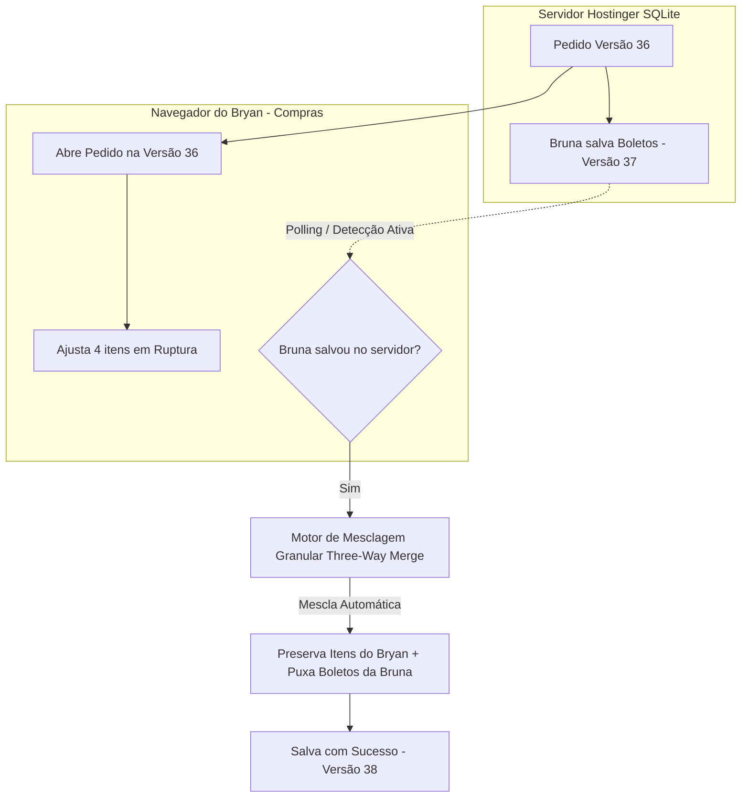

# 📋 Plano de Implementação: Sincronização Colaborativa Granular e Proteção de Concorrência

> **Status:** Proposta Técnica Pronta para Revisão  
> **Data:** 21/10/2026  
> **Prioridade:** Alta (Diretrizes de Ergonomia, UI/UX e Integridade Transacional)  
> **Origem:** Conflitos operacionais reais identificados entre **Bryan** (Compras) e **Bruna** (Faturamento) no pedido `839338`.

---

## 1. Contexto e Diagnóstico Operacional

No fluxo diário da Rede Mega 12, múltiplos setores atuam sobre o mesmo pedido:
- O **Comprador (Bryan)** negocia produtos, ajusta caixas, altera rupturas e define alocações de lojas.
- O **Faturamento (Bruna)** insere notas fiscais, desdobra parcelas de boletos, digita linhas digitáveis e ajusta centavos.
- A **Conferência/Logística** aponta avarias e conclui separações.

### O Problema Atual (Monolítico):
Atualmente, o pedido é salvo como um bloco único (`version` global). Quando a Bruna salva um boleto às 16:44:18 e o Bryan tenta salvar uma alteração de itens às 16:44:35 (17 segundos depois), o servidor recusa a gravação com `HTTP 409 (Conflito de Concorrência)`. O Bryan não consegue salvar suas alterações de ruptura/itens e fica bloqueado.

### A Solução: Arquitetura de Mesclagem Granular (*Three-Way Merge*)
Separar as responsabilidades por **domínios de dados**. Se a Bruna mexeu apenas no Financeiro e o Bryan mexeu apenas nos Produtos, o sistema une as duas alterações automaticamente, preservando 100% da digitação de ambos sem nenhum atrito.



---

## 2. Divisão dos Domínios do Pedido

Para permitir edição independente e segura, o payload e estado do pedido são particionados em 3 domínios estritos:

| Domínio | Campos / Tabelas Envolvidas | Responsável Primário |
| :--- | :--- | :--- |
| 🛒 **Compras / Catálogo** | `items` (quantidades, caixas, custos, descontos, `ruptura`), fornecedor, condições comerciais e grade de distribuição por loja | Comprador (Bryan / Rafael) |
| 💰 **Faturamento & Financeiro** | `installments` (parcelas, vencimentos, boletos, linhas digitáveis, comprovantes), dados de NF-e, chave fiscal e deduções financeiras | Faturamento (Bruna) / Diretoria |
| 📦 **Doca & Logística** | `status` da esteira, `avariasApontadas`, conferência física por filial e observações da separação | Conferente / Depósito |

---

## 3. Fases de Implementação

### Fase 1: Correção Emergencial do Backend *(Concluída ✅)*
- **Ação:** Declarada e validada a variável `isDiretoriaOrRoot` em `OrderService.sendToFaturamento` ([`order.service.js`](file:///c:/Users/Josue/Documents/App%20Rafael/backend/src/services/order.service.js#L1238-L1246)).
- **Objetivo:** Eliminar o `ReferenceError (HTTP 500)` que ocorria quando a Bruna ou a equipe tentavam encaminhar pedidos para o Faturamento com conferências parciais.

---

### Fase 2: Modo "Somente Leitura Preventivo" (Governança de Boletos)
Quando um pedido tiver boletos liberados para o Financeiro (`boletosLiberados === 1`):
1. **Frontend ([`OrderHeaderForm.tsx`](file:///c:/Users/Josue/Documents/App%20Rafael/web/src/components/OrderHeaderForm.tsx)):**
   - Se o usuário logado tiver perfil `comprador` e o pedido estiver bloqueado:
     - Exibir banner flutuante no topo:
       > 🔒 **Pedido em Modo Somente Leitura:** Os boletos deste pedido já foram liberados para o Financeiro. Edição restrita ao Faturamento e à Diretoria.
     - Desabilitar inputs de quantidades, caixas, exclusão de itens e botão de salvar.
     - Botão Salvar exibe: `🔒 Bloqueado pelo Financeiro`.
2. **Ergonomia (Clean UX):** O Comprador não gasta tempo alterando nada em pedidos já fechados para só descobrir no final que não tinha permissão.

---

### Fase 3: Detecção Ativa em Segundo Plano (Detector de Concorrência)
Evitar que o operador fique com a tela desatualizada por longos períodos enquanto outro colega trabalha no mesmo pedido.

1. **Backend — Endpoint Ultraleve de Verificação:**
   - Criar `GET /api/orders/:id/version-check`:
     - Retorna em ~2ms: `{ version, updatedAt, lastModifiedBy: { id, nome, role }, boletosLiberados, status }`.
     - Não carrega itens, grades ou joins pesados.
2. **Frontend — Hook `useOrderWatcher`:**
   - Executa a cada **15 segundos** enquanto o modal/tela do pedido estiver aberto.
   - Executa imediatamente quando a aba volta a ter foco (`window.onfocus` e `document.visibilitychange`).
   - Se a `version` no servidor for maior que a `version` carregada na tela:
     - Exibe barra de notificação suave no topo do pedido:
       > 🔔 **Atenção:** **Bruna (Faturamento)** salvou alterações neste pedido às **16:44**.  
       > `[ 🔄 Sincronizar Alterações ]`

---

### Fase 4: Motor de Mesclagem Granular (*Three-Way Merge*)
Quando o usuário clica em `[ 🔄 Sincronizar Alterações ]` ou ao clicar em `[ Salvar ]`:

1. **Snapshot de Três Vias:**
   - `Original (Base)`: O estado do pedido exatamente no instante em que o Bryan abriu a tela.
   - `Servidor (Remote)`: O estado salvo pela Bruna no banco.
   - `Rascunho Local (Local)`: O que o Bryan digitou e ainda não salvou.

2. **Algoritmo de Mesclagem por Campo:**
   - **Parcelas / Faturamento:**
     - Se o Bryan **não** alterou parcelas locais, adota imediatamente as parcelas da Bruna (`Servidor`).
     - Se a Bruna anexou boletos ou digitou linha digitável, eles entram na tela sem tocar nos itens.
   - **Itens / Ruptura / Quantidades:**
     - Se a Bruna **não** mexeu na lista de itens, adota 100% dos itens, quantidades e rupturas que o Bryan digitou (`Local`).
   - **Cabeçalho:**
     - Observações e flags são mesclados por timestamp mais recente ou combinados caso haja texto em ambos.

3. **Notificação de Sucesso Transparente:**
   - Toast informativo:
     > ✨ **Sincronização Concluída:** As atualizações de faturamento da Bruna foram incorporadas e seus 4 itens em ruptura foram mantidos intactos!

4. **Resolução Visual de Conflitos Diretos (Caso Extremo):**
   - Ocorre unicamente se a Bruna e o Bryan alterarem a quantidade ou a ruptura do **mesmo produto específico ao mesmo tempo**.
   - O sistema exibe um mini-modal ergonômico:
     > **Conflito no item "BALA MASTIGAVEL ZOLLE MACA VERDE 500G":**  
     > - Versão do Servidor (Bruna): *Em Ruptura (0 caixas)*  
     > - Sua Digitação (Bryan): *Disponível (10 caixas)*  
     > `[ Manter Minha Digitação ]` | `[ Usar Versão da Bruna ]`

---

### Fase 5: Backend Seguro & Transacional
1. **Payload Inteligente:**
   - Ao salvar, o frontend pode enviar `modifiedDomains: ['items']` ou `expectedVersion: 36`.
   - Se o servidor notar que a versão mudou de 36 para 37, mas a versão 37 alterou estritamente o domínio `'financial'`, o próprio backend aceita o merge com sucesso, avança para a versão 38 e grava o log de auditoria:
     ```text
     "Alteração mesclada com sucesso no domínio 'items' por BRYAN (comprador). 
      Campos de faturamento salvos por BRUNA (faturamento) foram preservados."
     ```
2. **Transação Atômica:**
   - Uso de `BEGIN TRANSACTION` / `COMMIT` com rollback garantido em caso de falha.

---

## 4. Tabela Comparativa: Antes vs. Depois

| Cenário Operacional | Como funciona Hoje (Com Falha) | Como funcionará com a Mesclagem Granular |
| :--- | :--- | :--- |
| **Bruna lança boletos enquanto Bryan digita rupturas** | Bryan clica em Salvar, toma `409 Conflito`, perde o que digitou e não consegue gravar. | O sistema detecta domínios distintos, mescla as parcelas da Bruna e grava as rupturas do Bryan com `200 OK`. |
| **Bryan abre pedido com boletos já liberados** | Bryan edita itens, mas o botão Salvar estoura erro `403 ORDER_LOCKED`. | A tela abre em modo somente leitura com aviso claro; Bryan não perde tempo digitando. |
| **Colega salva pedido enquanto o outro está com a aba aberta** | Ninguém sabe que houve mudança até tentar salvar e tomar erro. | Barra flutuante avisa em tempo real: *"Bruna salvou às 16:44 [Sincronizar]"*. |

---

## 5. Cronograma Sugerido de Execução

1. **Etapa 2.1:** Implementar Modo Somente Leitura Preventivo no frontend (`OrderHeaderForm.tsx`). *(Estimativa: 1 dia)*
2. **Etapa 2.2:** Criar endpoint rápido `GET /api/orders/:id/version-check` e hook `useOrderWatcher`. *(Estimativa: 1 dia)*
3. **Etapa 2.3:** Implementar o utilitário de *Three-Way Merge* no frontend (`orderMerge.ts`) e integrar no fluxo de salvamento. *(Estimativa: 1-2 dias)*
4. **Etapa 2.4:** Ajustar o `OrderService.saveOrder` para validar concorrência por domínio e registrar auditoria. *(Estimativa: 1 dia)*
5. **Etapa 2.5:** Homologação em conjunto com Bryan e Bruna na Hostinger.
