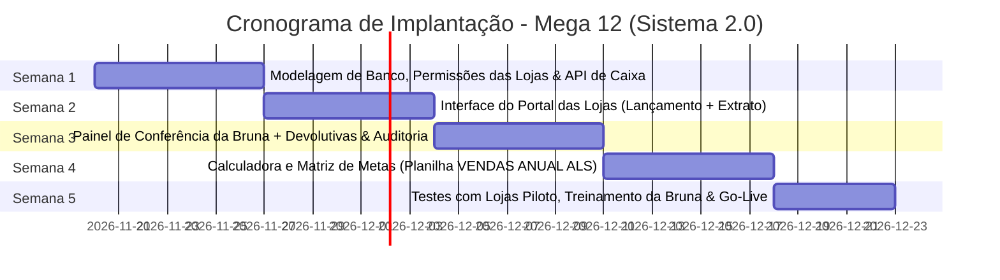

# Proposta Comercial & Planejamento Técnico — Sistema 2.0 (Lojas, Metas & Financeiro)
> **Cliente:** Rafael (Rede Mega 12 — 20 Lojas Físicas + CD Matriz)  
> **Autor & Engenheiro Responsável:** Josué  
> **Data:** 17/11/2026  
> **Documento Base Analisado:** `VENDAS ANUAL ALS.xlsx` (Raiz do Projeto)

---

## 🎯 1. Contexto & Escopo Detalhado do Ecossistema

O objetivo deste projeto é expandir o sistema Mega 12 para a **ponta da cadeia (as 20 lojas físicas)** e conectar a operação diária diretamente com o **Setor Financeiro (Bruna)** e a **Diretoria (Rafael)**, substituindo controles manuais por um fluxo digital ágil, auditável e em tempo real.

O ecossistema é composto por **3 Módulos Integrados**:

```mermaid
flowchart LR
    subgraph Modulo1 ["Módulo 1: Portal das Lojas"]
        L1["Lançamento do Caixa Diário<br/>(Dinheiro, Pix, Débito, Crédito)"]
        L2["Qtd. Vendas & Memorando"]
        L3["Extrato Mensal da Loja &<br/>Barra de Progresso da Meta"]
    end

    subgraph Modulo3 ["Módulo 3: Conferência Financeira"]
        F1["Fila Diária de Lojas"]
        F2["Conferência com Extratos"]
        F3["[Aprovar] ou [Devolver com Motivo]"]
    end

    subgraph Modulo2 ["Módulo 2: Matriz de Metas"]
        M1["Calculadora & Grid Anual<br/>(Fórmula VENDAS ANUAL ALS)"]
        M2["Meta Normal vs Supermeta (+10%)"]
        M3["Comissões (0.3% e 0.9%) & DRE"]
    end

    Modulo1 -->|"Envia Lançamento do Dia"| Modulo3
    Modulo3 -->|"Devolutiva / Solicitação de Ajuste"| Modulo1
    Modulo1 -->|"Alimenta Vendas Reais"| Modulo2
    Modulo2 -->|"Publica Metas e Ponto de Equilíbrio"| Modulo1
```

---

### Módulo 1: Portal de Acesso das Lojas (Frente Operacional)
*Interface ergonômica, intuitiva e focada na agilidade do fechamento diário da filial.*

1. **Autenticação por Loja:**
   - Acesso individualizado por unidade (ex: `loja.iratidp`, `loja.castro`, `loja.campolargo`, etc.).
   - A loja visualiza estritamente os seus dados, sem acesso a fornecedores, cotações ou números de outras filiais.
2. **Lançamento Diário do Caixa (Resultado do Dia):**
   - Data do movimento.
   - Decomposição dos valores por modalidade de pagamento:
     - **Dinheiro em Espécie (R$)**
     - **Pix (R$)**
     - **Cartão de Débito (R$)**
     - **Cartão de Crédito (R$)**
     - **Outros / Sangrias e Despesas Locais** (se houver pagamento feito pelo caixa).
   - **Quantidade de Vendas (Atendimentos):** Campo numérico simples para cálculo instantâneo do **Ticket Médio**.
   - **Memorando Diário / Observação:** Registro de ocorrências (ex: *"Chuva torrencial no período da tarde"*, *"Horário estendido até as 21h"*).
   - Soma automática em tempo real com validação antes do envio.
3. **Extrato Mensal & Acompanhamento de Vendas da Loja:**
   - Visão em calendário ou tabela de todos os dias do mês:
     - Status visual de cada dia: 🟡 *Aguardando Conferência*, 🟢 *Aprovado pelo Financeiro*, 🔴 *Ajuste Solicitado*.
     - Se o dia for devolvido pela Bruna, a loja vê o motivo com destaque e pode editar e reenviar.
   - **Barra de Progresso da Meta do Mês:**
     - `Vendido Hoje:` R$ X
     - `Acumulado no Mês:` R$ Y
     - `Falta para a Meta:` R$ Z (com % atingido)
     - `Falta para a Supermeta (+10%):` R$ W

---

### Módulo 2: Matriz & Calculadora de Metas (Diretoria / Rafael)
*Baseado integralmente na planilha `VENDAS ANUAL ALS.xlsx`, trazendo a visão geral estilo grade para um layout web moderno, limpo e dinâmico.*

1. **Visão Geral Comparativa (Estilo Planilha Dinâmica):**
   - Tabela comparativa anual por loja exibindo o histórico de **2021, 2022, 2023, 2024, 2025 e 2026**.
   - Seletor de Mês (Janeiro a Dezembro) com atualização instantânea da rede.
2. **Fórmulas e Regras Oficiais Decodificadas da Planilha:**
   - **Ponto de Equilíbrio:**
     $$\text{Ponto de Equilíbrio} = \frac{\text{Total das Despesas Fixas da Loja}}{31\%}$$
     *(Baseado na margem de contribuição líquida da rede de ~31% a 32%).*
   - **Meta Normal:** Valor estipulado para a loja cobrir custos e gerar resultado.
   - **Meta Super 10 (Supermeta):**
     $$\text{Supermeta} = \text{Meta Normal} + (\text{Meta Normal} \times 10\%) = \text{Meta Normal} \times 1{,}10$$
   - **Cálculo de Comissão da Meta Normal:**
     $$\text{Comissão Meta} = \text{Meta Normal} \times 0{,}3\%$$
   - **Cálculo de Comissão da Supermeta (10%):**
     $$\text{Comissão Supermeta} = \text{Supermeta} \times 0{,}9\%$$
   - **Simulação de DRE da Loja:**
     - $\text{Imposto Simples} = \text{Vendas} \times 8\%$
     - $\text{CMV (Custo Produto)} = \text{Vendas} \times 60\%$
     - $\text{Lucro Líquido} = \text{Vendas} - \text{CMV} - \text{Imposto Simples} - \text{Despesas Fixas}$
3. **Cálculo de Ritmo Diário & Projeção:**
   - Divisão da meta pelos dias úteis do mês.
   - Projeção em tempo real: *"No ritmo atual, a loja fechará o mês em R$ X (Y% da meta)"*.

---

### Módulo 3: Central de Gerenciamento & Conferência Financeira (Bruna / Financeiro)
*Painel focado em eliminar as 4 a 5 horas que a Bruna gasta conferindo comprovantes em papel e caneta.*

1. **Fila Diária de Conferência:**
   - Listagem consolidada de todas as lojas que enviaram o fechamento no dia.
   - Filtros rápidos: Por Data, Por Loja e Por Status (🟡 Pendente, 🟢 Conciliado, 🔴 Com Divergência).
2. **Painel de Análise do Lançamento:**
   - Visualização do detalhamento do caixa enviado pela loja (Dinheiro, Pix, Débito, Crédito, Despesas).
   - Campo para a Bruna confrontar com o extrato bancário e relatório das maquininhas.
3. **Ações de Devolutiva:**
   - **Botão `[Aprovar / Conciliar]`:** Valida o caixa, bloqueia alterações acidentais pela loja e consolida o número nas vendas oficiais da rede.
   - **Botão `[Solicitar Ajuste / Devolver]`:** Abre um modal ergonômico onde a Bruna aponta a divergência:
     - Exemplo: *"O valor do Pix lançado foi de R$ 1.450,00, mas no extrato bancário constam R$ 1.300,00. Favor conferir o comprovante das 16h40 e reenviar."*
   - O dia é imediatamente marcado como vermelho na loja com o aviso da Bruna para correção rápida.
4. **Trilha de Auditoria & Histórico de Correções:**
   - Registro de data/hora, quem aprovou, quem alterou e histórico da devolutiva para segurança jurídica e contábil.

---

## 📅 2. Cronograma & Duração da Implantação (4 a 5 Semanas)

Graças ao acelerador de desenvolvimento com IA e ao domínio prévio da arquitetura da Mega 12, a entrega completa é estimada em **4 a 5 semanas**, dividida nas seguintes etapas:

- **Semana 1:** Estruturação das tabelas de caixa, metas e conciliação no SQLite, isolamento de acessos por loja e endpoints da API.
- **Semana 2:** Construção da tela das lojas (lançamento diário do caixa, validações numéricas e extrato mensal com barra de metas).
- **Semana 3:** Construção do painel financeiro da Bruna (fila de conferência, botões de aprovação/devolutiva com histórico).
- **Semana 4:** Implementação da Matriz de Metas e Supermetas da Diretoria (visual idêntico à planilha `VENDAS ANUAL ALS`, cálculo de comissões, ponto de equilíbrio e DRE simulado).
- **Semana 5:** Homologação com 2 lojas piloto, treinamento com a Bruna e virada oficial para as 20 lojas da rede.

---

## 💳 3. Orçamento & Formas de Pagamento

Levando em conta o porte da rede (20 lojas físicas), o impacto direto na economia de tempo da equipe e a infraestrutura já consolidada, apresentamos **2 opções comerciais**:

---

### Opção A: Projeto Fechado Parcelado (Englobando os 3 Módulos)
*Indicado para quem prefere contratar o desenvolvimento como um pacote de escopo fechado.*

- **Escopo Completo:**
  - Módulo 1 (Portal das Lojas: Caixa Diário + Extrato Mensal);
  - Módulo 2 (Calculadora e Matriz de Metas e Supermetas `VENDAS ANUAL ALS`);
  - Módulo 3 (Central de Conferência da Bruna com Fila e Devolutivas);
  - Carga inicial do histórico de metas das 20 lojas da rede (2021 a 2026).
- **Investimento Total:** **R$ 13.800,00**
- **Condições de Pagamento Facilitadas:**
  - **4 parcelas de R$ 3.450,00** (Entrada + 30 / 60 / 90 dias);
  - *Ou em **3 parcelas de R$ 4.600,00** vinculadas à entrega dos marcos.*
- *Análise de Custo:* Representa um investimento de apenas **R$ 690,00 por loja** para informatizar toda a frente de caixa, conciliação e metas da rede.

---

### Opção B: Modelo Híbrido (Implantação Reduzida + Contratação Mensal de Sustentação) — ⭐ A Mais Recomendada
*Indicado para quem busca menor desembolso de entrada e garantia de suporte e evolução contínua com 20 lojas operando online diariamente.*

- **Taxa Única de Implantação dos 3 Módulos:** **R$ 5.400,00**  
  *(Pode ser dividida em **2x de R$ 2.700,00** ou **3x de R$ 1.800,00** durante a fase de desenvolvimento).*
- **Mensalidade de Gestão, Suporte & Evolução Contínua:** **R$ 1.650,00 / mês**  
  *(Iniciada após a entrega oficial e validação dos 3 módulos).*

#### O que está incluso na Contratação Mensal:
1. **Monitoramento e Sustentação da Infraestrutura:** Manutenção do servidor VPS Linux, rotinas diárias automáticas de backup em nuvem e integridade do banco de dados das 20 filiais.
2. **Suporte Prioritário:** Suporte técnico para resolução de dúvidas operacionais da Bruna, matriz e gerentes de loja.
3. **Evolução Contínua Sem Custos Extras:** Pequenas melhorias, ajustes de relatórios, novos filtros e adequações operacionais solicitadas pelo Rafael ou pela Bruna sem necessidade de aprovação de novos orçamentos.
4. **Custo por Loja Irrisório:** R$ 1.650 / 20 lojas = **R$ 82,50 por loja/mês** (uma fração do custo de qualquer software de mercado).

---

## 📊 4. Quadro Comparativo das Opções

| Critério | Opção A (Projeto Fechado) | Opção B (Implantação + Mensalidade) |
|---|:---:|:---:|
| **Investimento de Entrada** | R$ 3.450,00 (1ª parcela) | R$ 1.800,00 (1ª parcela) |
| **Investimento Total de Implantação** | R$ 13.800,00 | R$ 5.400,00 |
| **Custo Recorrente Pós-Entrega** | R$ 0,00 *(novas melhorias cobradas avulso)* | R$ 1.650,00 / mês |
| **Suporte & Monitoramento Diário** | 30 dias de garantia pós-entrega | **Incluso e contínuo para as 20 lojas** |
| **Novos Ajustes e Melhorias** | Sob orçamento pontual | **Inclusos dentro da mensalidade** |
| **Ideal Para:** | Pagamento pontual de projeto | **Parceria estratégica de longo prazo** |

---

## 🚀 5. Próximos Passos para Início

1. Alinhamento com o Rafael para escolha da forma de pagamento (**Opção A** ou **Opção B**).
2. Validação da data de corte do caixa das lojas (início da operação oficial).
3. Criação da branch de desenvolvimento e início do **Marco 1 (Semana 1)**.

