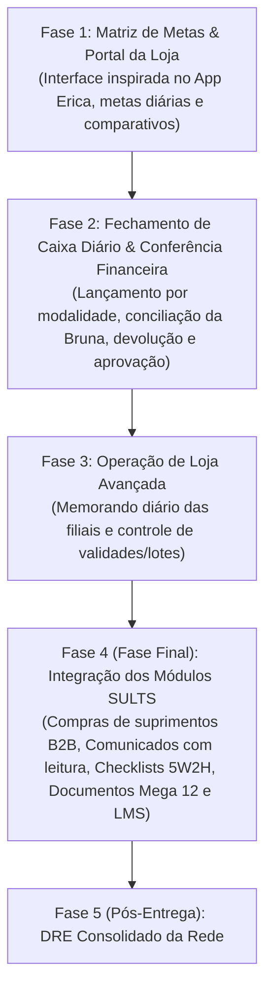

# Avaliação e Diagnóstico dos Módulos SULTS — Demonstração Operacional (Bryan)

> **Documento Normativo e Técnico**  
> **Data:** 19/11/2026  
> **Fontes Examinadas:**  
> 1. Vídeo de demonstração operacional: `WhatsApp Video 2026-11-19 at 14.20.53.mp4` (75,7 s — análise frame a frame e transcrição integral do áudio de Bryan).  
> 2. Modelagem técnica de referência: Pasta `ERP Joia 2` (`ANTIGRAVITY_SULTS_SPEC.md`, `PLANO_IMPLEMENTACAO.md`, schema Prisma relacional).  
> 3. Sistema atual em produção: `App Rafael` (backend Express + SQLite `mega12.db` e frontend React Router modularizado).  
> **Decisão Estratégica:** Os módulos **NÃO** serão construídos como um sistema isolado. Serão integrados diretamente no sistema operacional atual (`App Rafael`), constituindo a **FASE FINAL DA TRANSIÇÃO 2.0**.

---

## 1. Transcrição Integral do Relato Operacional (Bryan)

O áudio do vídeo gravado pelo Bryan foi extraído e transcrito na íntegra para fundamentar com precisão o que a operação da Mega 12 efetivamente utiliza:

> *"Gravar um videozinho.*  
> - *As **Unidades**: que a gente cadastra todas as unidades que são, né, pra elas terem um acesso a isso, não sei se vai usar, né.*  
> - ***Mega 12**: é pra todos os documentos, dá pra guardar documento, cadastrar pessoas também.*  
> - *Sistema de **Compras**: que a gente usa pra... pra fazer compras de materiais de expediente, sacolas, essas coisas assim.*  
> - *Os **Comunicados**: que daí a gente larga os avisos, né.*  
> - *O **Checklist** do supervisor.*  
> - ***Agenda**: não usa tanto, mas dá pra pôr, uma agendinha.*  
> - ***Universidade Corporativa**: é onde a gente faz os treinamentos do SULTS, e a gente treina o... interno da loja, né.*  
> - ***Implantação de Unidades**: que é quando vai inaugurar uma loja dá pra usar um checklist e fazer um plano, né.*  
> - *Os **Analytics**: que é análise de checklist e coisa assim.*  
> - *A **Rede Social**: acho que não é preciso.*  
> - ***Jornada**: também é de... a jornada de serviço, do tempo do... que os supervisores tão fazendo e tal.*  
> - ***Integração / Expansão**: não.*  
> - ***Marketing**: também não.*  
> - *O **NES**: é um negócio de pra saber como é que tá as lojas, ou se tá tudo bem, dá pra fazer tipo uns questionários.*  
> - *Esse **NPS**: também quase a mesma coisa.*  
> - *E os **Termos LGPD**: é os... os treinamentos [ou aceites de termos]. Acho que é isso aí."*

---

## 2. Matriz Decisória de Escopo (O que Fazer vs. O que Descartar)

Com base na fala explícita do Bryan, os módulos dividem-se em três grupos claros:

### 2.1 Módulos Confirmados (Escopo da Fase Final do Sistema 2.0)

| Módulo SULTS | Função na Rede Mega 12 | Fala do Bryan | Estratégia no Sistema Atual (`App Rafael`) |
|---|---|---|---|
| **Compras** | Requisição de materiais de expediente, sacolas e suprimentos de consumo | *"pra fazer compras de materiais de expediente, sacolas..."* | Criar catálogo de insumos internos onde a loja pede e a Matriz/Estoque separa e envia. |
| **Comunicados** | Circulares, avisos operacionais, alertas urgentes com confirmação de leitura | *"que daí a gente larga os avisos né."* | Feed na tela inicial, pop-ups bloqueantes para avisos urgentes e relatório de quem leu e quando leu. |
| **Checklists** | Vistorias técnicas e operacionais dos supervisores nas lojas | *"O Checklist do supervisor."* | Questionários divididos por setores com fotos obrigatórias na reprovação e pontuação. |
| **Planos de Ação (5W2H)** | Resolução de não conformidades apontadas nos checklists | Desdobramento natural do checklist | Abertura automática de pendências com prazo, responsável e envio de evidências fotográficas. |
| **Mega 12 (Pessoas & Docs)** | Repositório central de documentos da rede e colaboradores | *"pra todos os documentos, guardar documento, cadastrar pessoas..."* | GED (Disco Virtual por pastas) de documentos corporativos e ficha de funcionários por filial. |
| **Unidades** | Cadastro mestre de lojas físicas e seus acessos | *"cadastra todas as unidades que são... pra terem acesso"* | Tabela relacional de filiais (`units`), vinculando usuários, gerentes, endereço, CNPJ e metas. |
| **Universidade Corporativa** | Treinamentos internos e capacitação de colaboradores | *"onde a gente faz os treinamentos... treina o interno da loja"* | Cursos, videoaulas, manuais em PDF e questionários de fixação da equipe. |
| **Implantação de Unidades** | Checklist e cronograma de abertura de novas filiais | *"quando vai inaugurar uma loja dá pra usar checklist e plano"* | Cronograma de tarefas e checklist pré-inauguração para novas filiais. |
| **Analytics** | Gráficos e indicadores de conformidade das lojas | *"análise de checklist e coisa assim."* | Painel de BI com ranking de notas das lojas e histórico de conformidade. |

### 2.2 Módulos Opcionais / A Avaliar
- **Agenda:** Calendário simples de compromissos e visitas de supervisão.
- **NES (Clima Interno) & NPS:** Questionários periódicos anônimos para a equipe avaliar clima e satisfação.
- **Chamados (Helpdesk):** Abertura de tickets da loja para a Matriz (TI, Manutenção, RH).
- **Termos LGPD & Jornada:** Aceite digital de políticas internas e registro de check-in de supervisão.

### 2.3 Módulos Descartados (Fora do Escopo)
- ❌ **Rede Social:** Descartado pelo Bryan (*"acho que não é preciso"*).
- ❌ **Integração / Expansão:** Descartado pelo Bryan (*"não"*).
- ❌ **Marketing Externo:** Descartado pelo Bryan (*"também não"*).

---

## 3. Arquitetura de Integração: Não Criar Sistema Isolado

A pasta `ERP Joia 2` foi estruturada em NestJS + PostgreSQL + Next.js 15. No entanto, por decisão estratégica:
1. **Zero Duplicação de Infraestrutura:** Não será inicializado um segundo servidor ou banco paralelo no VPS Hostinger.
2. **Single Sign-On (Login Único):** O colaborador, gerente de loja e supervisor acessarão todas as funcionalidades com a mesma conta no `App Rafael`.
3. **Reaproveitamento dos Schemas:** Os modelos de dados já definidos em `ERP Joia 2/apps/api/prisma/schema.prisma` (`units`, `announcements`, `checklists`, `action_plans`, `b2b_orders`, `disk_folders`, `lms_courses`) servem de referência direta para criação das migrações SQL no banco SQLite (`mega12.db`).
4. **Navegação Web Multi-Páginas:** Com o roteamento via `react-router-dom` recém-implantado no frontend web, as novas telas entram como módulos em `web/src/modules/` (`modules/announcements`, `modules/checklists`, `modules/supplies`, `modules/units`).

---

## 4. Posicionamento no Roadmap do Sistema 2.0

A incorporação desses módulos compõe a **Fase Final da Mudança 2.0**, organizada no seguinte fluxo:

Com esta estruturação, o projeto 2.0 foca inicialmente nas dores financeiras imediatas da rede (fechamento de caixas, conferência da Bruna e metas da diretoria) e encerra a transição internalizando as rotinas operacionais do SULTS em uma plataforma totalmente própria e unificada.
